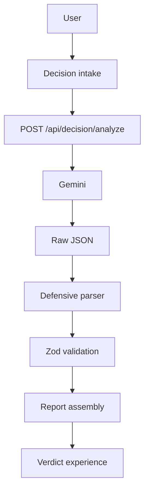

# Decision Court

A hard decision, examined from both sides, with the uncertainty left visible.

Decision Court is an AI-powered decision-analysis experience. It does not act as a yes-or-no oracle. It builds the case for and the case against, challenges the assumptions underneath both, weighs the evidence that was actually supplied, and returns a balanced verdict.

The report includes what is still unknown, and the specific changes that could move the conclusion.

**Repository:** [singh-khushi30/decision-court](https://github.com/singh-khushi30/decision-court)

## Table of Contents

- [Overview](#overview)
- [Why Decision Court?](#why-decision-court)
- [How It Works](#how-it-works)
- [What Would Change the Verdict?](#what-would-change-the-verdict)
- [Product Experience](#product-experience)
- [Architecture](#architecture)
- [AI & Structured Output](#ai-structured-output)
- [Reliability & Validation](#reliability-validation)
- [Tech Stack](#tech-stack)
- [Project Structure](#project-structure)
- [Getting Started](#getting-started)
- [Environment Variables](#environment-variables)
- [Running Locally](#running-locally)
- [Testing](#testing)
- [Design Direction](#design-direction)
- [Key Engineering Decisions](#key-engineering-decisions)
- [Future Improvements](#future-improvements)

## Overview

Decision Court helps a person slow down a difficult choice. They describe the decision and the context around it. The product returns an Advocate case, a Challenger case, the assumptions those cases depend on, an evidence reading, and a Judge's synthesis.

The verdict is a reading of the supplied information. It is not a command to act, and analysis confidence is not the probability that a choice will succeed.

## Why Decision Court?

Important decisions rarely have one objectively correct answer. Ordinary assistants often skip to a recommendation while the tradeoffs, missing facts, and weak assumptions stay hidden.

Decision Court keeps those parts on the page. Opposing arguments sit next to each other. Evidence is scored as thin, mixed, or grounded. Unresolved questions stay open. The conclusion can move when a specific fact changes, and the report says which facts those are.

## How It Works

The stages below are the shape of the reading. They are written together in one analysis, then assembled into the report.

**01 — Frame the Decision**  
The person states the decision, the current situation, goals, constraints, and timeline. Only that supplied context is in scope.

**02 — Build the Cases**  
The Advocate makes the strongest honest case for the choice. The Challenger makes the strongest honest case against it. Inferences are labeled as assumptions.

**03 — Cross-Examine**  
Assumptions from both sides are challenged. Questions that the supplied context cannot answer stay unresolved.

**04 — Evaluate Evidence**  
A small set of dimensions, including evidence quality, records how well the available information supports a reading. Scores are indicators, not probabilities.

**05 — Deliver the Verdict**  
The Judge synthesizes the cases and the evidence into a verdict, analysis confidence, a bottom line, what would change the verdict, next steps, and a summary.

## What Would Change the Verdict?

Most decision tools stop at a conclusion. Decision Court also names the conditions that would materially change that conclusion.

Each factor has a condition, the shift it would cause, and why it matters. The point is practical: the person can see which missing fact is doing the most work, and what to learn before treating the verdict as settled.

*Example, not a generated result.* Someone is considering a move for a year.

| If this were true | The reading would shift |
| --- | --- |
| Returning within six months was inexpensive | The downside of trying the city gets smaller |
| Remote work ended after the move | The financial case for moving gets weaker |

## Product Experience

**Landing** (`/`)  
Introduces the courtroom metaphor and starts a new decision.

**Decision intake** (`/decide`)  
Collects the decision and the surrounding context: situation, goals, constraints, and timeline. The draft stays in `sessionStorage` for the browser tab.

**Analysis** (`/analysis`)  
Shows the review while the analysis request runs, then opens the verdict. Prepared copy at `/analysis/demo` uses a fixed example and does not call the model.

**Verdict** (`/verdict/result`)  
The finished report, also kept in `sessionStorage`. It includes:

- verdict label
- analysis confidence
- dimension scores
- the case for and the case against
- key insights
- what would change the verdict
- an action plan of next steps
- a summary

`/verdict/demo` shows the same report layout with prepared copy and does not call the model.

## Architecture



There is no database and no account system. The decision is sent to Gemini for that analysis. The finished report lives in the browser tab.

## AI & Structured Output

A successful analysis is one Gemini request. A concise prompt asks for the full report as JSON: Advocate, Challenger, challenged assumptions, unresolved questions, evidence dimensions, verdict, analysis confidence, bottom line, insights, change factors, next steps, and summary.

Advocate, Challenger, cross-examination, evidence evaluation, and Judge are reasoning roles inside that structured response. They are not separate model calls.

The reply is handled in order:

1. Raw JSON, with one surrounding code fence removed when the whole message is fenced.
2. `JSON.parse`. Prose mixed with JSON is rejected.
3. Zod validation of the model output.
4. Deterministic assembly into the report the interface already renders.

Chain-of-thought is not requested and is not shown. The model is instructed not to choose for the person.

`GEMINI_MODEL` selects the model. When it is empty, the server uses `gemini-3.8-flash`.

## Reliability & Validation

The request body is checked before the model is called. The model response is checked again before a report is shown. Scores, array lengths, required sections, and controlled values such as the verdict label stay in Zod. Those checks are not relaxed to accept a partial answer.

The analysis has one 40 second deadline and an output ceiling of 3500 tokens. A fast provider 503 may be tried once more inside that same deadline. Timeouts, authentication failures, malformed JSON, truncated JSON, and schema failures do not become a second analysis, and they do not become a made-up verdict. The interface shows a controlled error instead.

In development, invalid output can log structural diagnostics such as parse stage, issue paths, finish reason, and output token count. Those logs do not include the decision, the raw response, or the API key.

Automated tests mock the provider. `npm test` does not call Gemini.

The analyze route also applies a best-effort in-memory limit of 5 analyses per 10 minutes per client address. It resets when the server process restarts and does not coordinate across multiple servers.

## Tech Stack

| Technology | Purpose |
| --- | --- |
| Next.js (App Router) | Application framework and the analysis route |
| React | Interface |
| TypeScript | Typed application code |
| Tailwind CSS | Styling |
| shadcn/ui | Interface primitives |
| Motion | Analysis-screen motion |
| `@langchain/google-genai` | Gemini request |
| Zod | Request and model-output validation |
| React Hook Form | Decision intake |
| Lucide | Icons, including the scales mark |
| Vitest | Unit and component tests |
| ESLint | Linting |

## Project Structure

```text
src/
  app/                  routes: landing, decide, analysis, verdict, analyze API
  components/
    landing/            landing page
    decision/           intake flow
    analysis/           analysis screen
    verdict/            verdict report
  lib/
    agents/             prompt, one-call analysis, report assembly
    ai/                 Gemini client, JSON parser, errors, logging
    schemas/            request, model-output, and report schemas
scripts/
  gemini-smoke.mjs      optional live Gemini check
  gemini-models.mjs     optional model list
```

Tests live next to the code they cover, including `src/app/api/decision/analyze/route.test.ts` and `src/lib/agents/analyze.test.ts`.

## Getting Started

Requirements: Node.js 20 or newer, and npm.

```bash
git clone https://github.com/singh-khushi30/decision-court.git
cd decision-court
npm install
cp .env.example .env.local
```

Put your Gemini API key in `.env.local`. That file is gitignored. Do not commit it.

## Environment Variables

| Variable | Purpose |
| --- | --- |
| `GEMINI_API_KEY` | API key for Gemini. Read only on the server. |
| `GEMINI_MODEL` | Optional model id. When empty, the server uses `gemini-3.8-flash`. |
| `GEMINI_FALLBACK_MODEL` | Listed in `.env.example`. The current analysis request does not use it. |

```bash
GEMINI_API_KEY=your_api_key_here
GEMINI_MODEL=
```

Restart `npm run dev` after changing `.env.local`. Next reads environment variables when the server starts.

## Running Locally

```bash
npm run dev
```

Open [http://localhost:3000](http://localhost:3000).

`npm run build` makes a production build. `npm start` serves that build.

## Testing

```bash
npm test
npm run lint
npm run build
```

`npm run test:watch` runs Vitest in watch mode.

`npm test` does not call Gemini. `npm run test:gemini` makes one small live call with the same client configuration as the app. `npm run gemini:models` lists models this key can use for `generateContent` and does not generate text. Neither command is part of `npm test` or `npm run build`.

## Design Direction

The interface is editorial rather than a generic dashboard. The palette is ivory, cream, and ink, with brass for the scales and for emphasis. Cormorant Garamond carries the headlines. A script accent appears sparingly. The courtroom metaphor, scales, Advocate, Challenger, and Judge, frames the product as a hearing rather than a chatbot transcript.

## Key Engineering Decisions

- One Gemini call produces the whole analysis. Extra model orchestration is not on the request path.
- Zod validates the model output at the boundary. The interface does not trust raw text.
- Report assembly is deterministic. Labels, tones, and the confidence note are applied in code after validation.
- Provider failures, timeouts, and invalid JSON surface as controlled errors. The app does not invent a fallback verdict.
- Analysis confidence describes how complete the supplied information is. It is not presented as the chance the decision will succeed.
- Advocate, Challenger, and Judge are roles in the structured report, not independent autonomous agents.

## Future Improvements

These are not in the current experience:

- Saved decision history
- Comparing more than one scenario
- User-controlled weighting of dimensions
- Attachments or sources as evidence
- A richer view of how sensitive the verdict is to each factor
- Exporting or sharing a verdict
